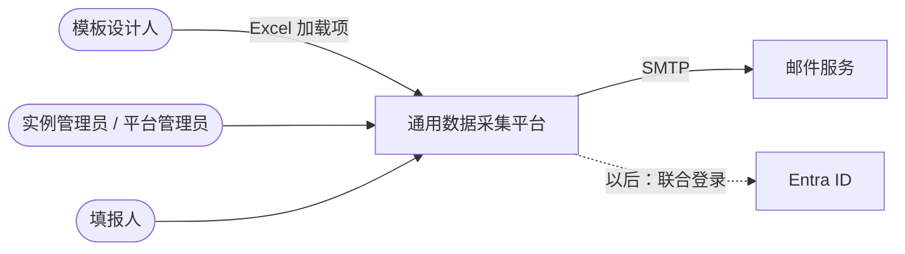
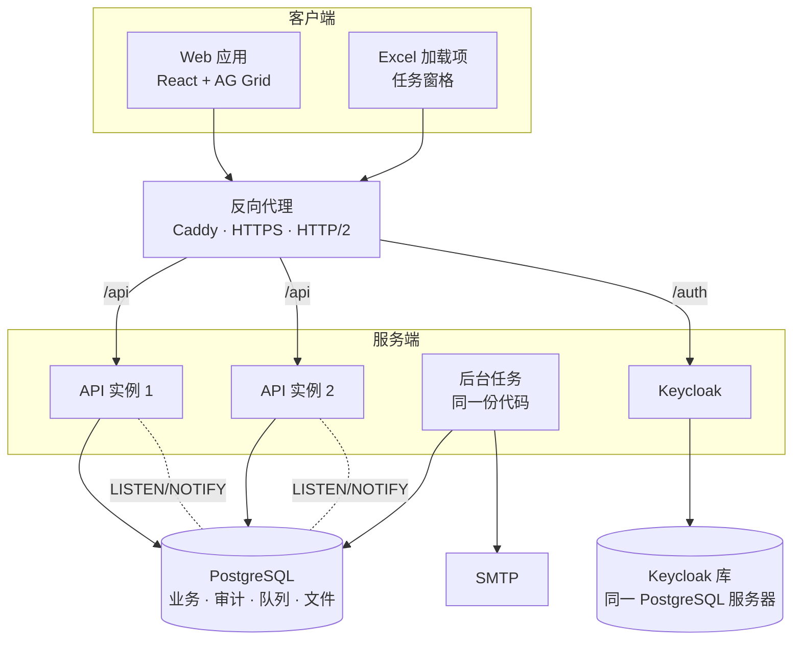
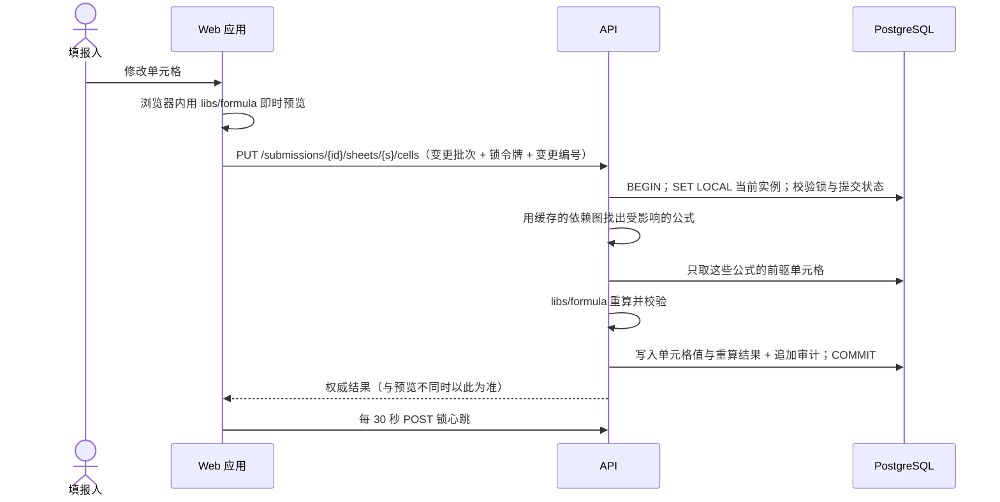
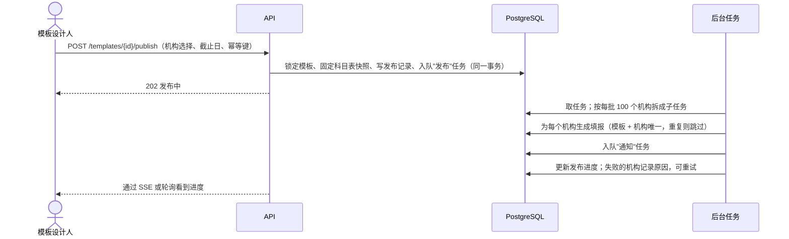
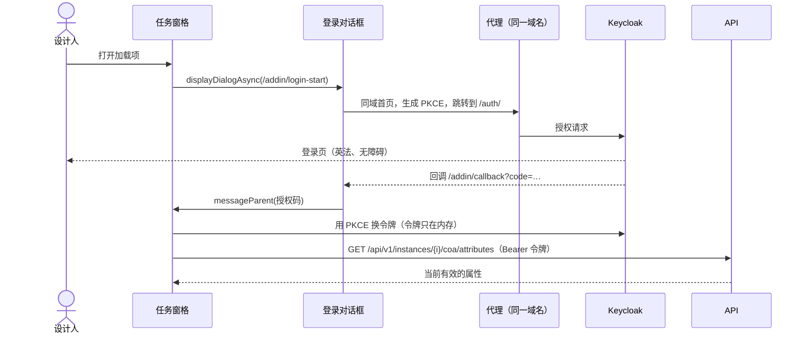
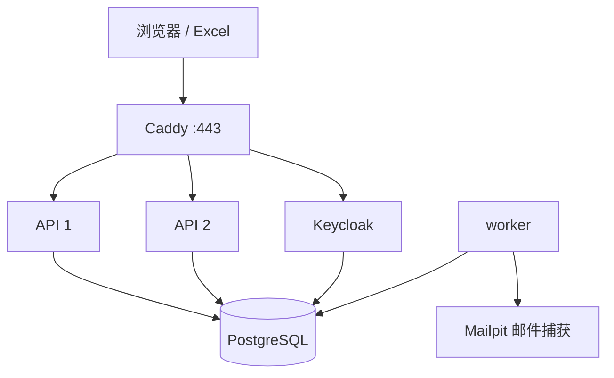

# 架构总览

相关决策见 `docs/adr/`。本文和 ADR 冲突时，以状态为"已接受"的最新 ADR 为准，并尽快修正本文。

这是一个从零重建的项目。老系统（GDCT_PlanB、GDCT_TDT）只作需求参照，见 `docs/product/legacy-scope.md`。

## 架构指标

"来源"一列：用户 = 用户回答；AI = AI 估算，待用户确认；ADR = 探针实测。

| 指标 | 目标 | 依据 |
|---|---|---|
| 机构数 / 用户数 | 几千机构 / 几万用户 | vision·规模（用户） |
| 峰值并发 | 1000 到 3000 个会话 | 用户确认设计按此量级 |
| 单模板一轮的数据量 | 约 1500 万个单元格值（3000 机构 × 5000 格） | AI 估算；用户确认按此设计 |
| 审计行数 | 一个模板一轮约 3000 万到 5000 万行（每格平均改 2 到 3 次） | AI 估算（REQ-019） |
| 打开模板 | 3 秒内可编辑 | vision·性能 |
| 浏览器编辑预览 | P95 100 ms 内 | ADR-0001 |
| 服务端保存与校验 | 500 ms 内返回；峰值约 300 次/秒（待压测，Q-024） | vision·性能；AI 估算 |
| 可用性 | 截止日前后 99.9%（上线后） | 用户 |
| 数据恢复 | 丢数据不超过 5 分钟（RPO），4 小时内恢复（RTO） | 用户 |
| 强一致 | 单元格保存与其审计、提交与快照、授权变更、工作表锁 | REQ-019、024、027 |
| 可以晚几秒 | 发布后为各机构生成填报、邮件、提醒、留存清理 | REQ-018、028、033 |
| 合规 | WCAG 2.1 AA；英法双语；数据驻留加拿大；PIA/TRA | REQ-029 到 031 |
| 成本 | 没有硬上限；免费开源优先；避免按用量失控的服务 | 用户 |
| 维护 | AI 开发和维护，用户是产品负责人与验收人；运维越少越好 | vision·约束 |
| 第一期运行环境 | 仅本地（docker compose）；CI 自动检查；不建线上环境 | 用户（REQ-032） |

## 架构风格

模块化单体：一个后端代码库、一个数据库，按业务模块分目录，模块边界由工具强制；同一份代码以"API"和"后台任务"两种模式运行。理由：规模不需要分布式；事务和审计必须在一起；一个人加 AI 维护得动；公式引擎与浏览器共用同一份 TypeScript。详见 ADR-0003、ADR-0004。

## 系统上下文

外部依赖只有邮件服务（线上用谁见 Q-025）和以后可能接入的 Entra ID（Q-001）。

## 分层

后端每个模块内部：

| 层 | 职责 | 可以依赖 |
|---|---|---|
| `routes` | 接收请求、用 zod 校验输入、调用 services、返回结果 | services、`shared`、`libs` |
| `services` | 业务逻辑和事务边界；调用别的模块的公开入口 | repositories、domain、`shared`、其他模块的 `index.ts`（按下表方向）、`libs` |
| `repositories` | 数据访问（Drizzle），只操作本模块拥有的表 | domain、`shared` |
| `domain` | 领域模型和业务规则，纯 TypeScript | 无 |

模块之间只能通过对方的 `index.ts` 公开入口调用，方向见下表，禁止循环，禁止直接读写对方的表（ADR-0004）。

前端（`apps/web`）：`app` → `features/*/pages` → `features/*/components`（展示组件）与 `features/*/data-access`；`shared/ui`、`shared/lib`。展示组件不取数据。规则按规范库 `react-ts`。

共享包 `libs/*` 不依赖任何应用；`libs/formula` 必须能在 Node 和浏览器里运行（不用 Node 专有接口）。

## 组件

| 组件 | 目录 | 技术栈 | 职责 | 拥有的数据 | 对外接口 | 依赖 |
|---|---|---|---|---|---|---|
| API | `apps/api` | TypeScript、Fastify、zod、Drizzle | 业务逻辑、授权、校验、权威的公式重算、SSE | 业务数据（下表各模块） | `/api/v1`（REST + OpenAPI）、`/api/v1/events`（SSE） | PostgreSQL、Keycloak（令牌校验、用户管理接口）、`libs/*` |
| 后台任务 | `apps/api`（`ROLE=worker`） | 同上，pg-boss | 批量生成填报、导入、邮件、提醒、留存清理 | 无（读写同一数据库） | 无 | PostgreSQL、SMTP |
| Web 应用 | `apps/web` | React、Vite、AG Grid Community、React Aria Components | 管理界面、模板预览、在线填报 | 无 | 浏览器 | API、Keycloak（登录） |
| Excel 加载项 | `apps/addin` | TypeScript、Vite、Office.js、React Aria Components | 模板设计工具：登录后拉取科目表，插入属性和分类 | 无 | Excel 任务窗格 | API、Keycloak（登录） |
| 身份服务 | 镜像 + `infra/keycloak/` | Keycloak（Apache-2.0） | 登录、密码、MFA、锁定、找回、令牌 | 凭证和会话 | OIDC（授权码 + PKCE） | 自己的数据库 |
| 数据库 | `infra/` | PostgreSQL | 全部持久数据 | 见"数据" | SQL | 无 |
| 反向代理 | `infra/caddy/` | Caddy | 单一域名、HTTPS、路径分发、静态文件、请求编号 | 无 | 443 | 以上各服务 |
| 共享包 | `libs/schemas`、`libs/formula`、`libs/i18n` | TypeScript | zod 结构；公式引擎与函数白名单；英法文案 | 无 | npm 包（工作区内） | 无 |

### 后端模块和允许的依赖

| 模块 | 拥有的数据 | 允许使用的模块 | 覆盖需求 |
|---|---|---|---|
| `iam` | 实例、用户、角色、权限、授权 | `audit` | REQ-001 到 004 |
| `organizations` | 机构、机构属性定义与取值、机构分类维度与取值 | `iam`、`audit` | REQ-005、006 |
| `periods` | 财年、报告期 | `audit` | REQ-007 |
| `coa` | 计量单位、属性、分类组、分类、选项列表 | `audit` | REQ-008 到 013 |
| `templates` | 模板、模板版本、数据点、科目表快照、原始工作簿 | `coa`、`periods`、`audit` | REQ-015 到 017 |
| `collection` | 发布记录、填报、单元格值、提交快照、工作表锁 | `templates`、`organizations`、`iam`、`coa`、`audit` | REQ-018、020 到 027 |
| `notifications` | 邮件模板、发送记录 | `iam`、`organizations`（由任务队列触发，其他模块不直接调用它） | REQ-028 |
| `audit` | 审计日志 | 无 | REQ-019 |
| `shared`（不是模块） | 配置、错误类型、批量导入框架、文件存储接口、任务封装、事务与租户上下文 | 无 | REQ-013、025 的框架 |

批量导入框架在 `shared`：每个模块提供自己的导入处理器，框架负责事务、逐行逐列错误报告、幂等。

## 关键场景

### 编辑、自动保存与增量重算（REQ-021 到 024）

### 发布模板给机构（REQ-018）

### Excel 加载项登录（ADR-0002）

## 部署

第一期只有本地环境，没有线上环境。线上平台未定（Q-002），定了再配部署流水线。

| 组件 | 环境 | 实例数 | 有无状态 | 扩容方式 | 健康检查 |
|---|---|---|---|---|---|
| API | 本地 | 2 | 无状态（锁、会话在数据库） | 水平加实例 | `/health/live`、`/health/ready` |
| 后台任务 | 本地 | 1 | 无状态；定时任务由 pg-boss 保证只跑一次 | 水平加实例 | `/health/live` |
| Web / 加载项静态文件 | 本地 | 由 Caddy 提供 | 无状态 | 随代理 | 代理自检 |
| Keycloak | 本地 | 1（线上至少 2） | 会话在数据库 | 水平加实例 | `/health/ready` |
| PostgreSQL | 本地 | 1 | 有状态 | 线上用托管主备，开启连续归档（时间点恢复） | 驱动连接检查 |
| Caddy | 本地 | 1 | 无状态 | 线上用平台负载均衡 | 自检 |
| Mailpit | 仅本地与 CI | 1 | 无 | 不适用 | 不适用 |

本地开发：`infra/docker-compose.yml` 一条命令启动以上全部，带种子实例和演示数据（REQ-032）。CI 中同一份编排用于端到端测试。

上线时（Q-002 之后）的参考：托管 PostgreSQL（加拿大区域，时间点恢复满足 RPO 5 分钟）；API 至少两个实例；Keycloak 至少两个实例。具体平台未定。

## 数据

| 数据 | 主人 | 存储 | 一致性 | 备份 |
|---|---|---|---|---|
| 实例、用户、角色、授权 | `iam` | PostgreSQL | 强一致；授权变更立即生效（缓存通过 NOTIFY 失效） | 数据库备份 |
| 机构、机构属性、分类 | `organizations` | PostgreSQL | 强一致 | 同上 |
| 财年、报告期 | `periods` | PostgreSQL | 强一致 | 同上 |
| 科目表（单位、属性、分类组、分类、选项列表） | `coa` | PostgreSQL；名称用多语言 JSONB | 强一致 | 同上 |
| 模板（版本、数据点、布局、公式）与科目表快照 | `templates` | PostgreSQL；布局和公式用 JSONB，数据点是行 | 强一致；发布后不可变 | 同上 |
| 原始工作簿、导入导出文件 | `templates`、`collection`（通过文件存储接口） | PostgreSQL（以后可换对象存储适配器） | 与业务数据同事务 | 同上 |
| 填报、单元格值 | `collection` | PostgreSQL；单元格值表按提交哈希分区；带类型的列 | 强一致；每次保存一个事务，与审计同事务 | 同上 |
| 提交快照 | `collection` | PostgreSQL；提交时复制当前行，不可变 | 强一致 | 同上 |
| 工作表锁 | `collection` | PostgreSQL（带过期时间） | 强一致 | 不需要恢复 |
| 审计日志 | `audit` | PostgreSQL；按月范围分区；只追加 | 与业务同事务 | 同上；留存按实例配置（REQ-033） |
| 后台任务队列 | pg-boss | PostgreSQL | 与业务同事务入队 | 同上 |
| 凭证与会话 | Keycloak | 自己的数据库（同一 PostgreSQL 服务器） | 由 Keycloak 负责 | 同上 |

- **租户隔离**：所有租户表有 `instance_id`；代码里按实例过滤，数据库再加行级安全：每个事务开头 `SET LOCAL app.instance_id`，策略拒绝越界读写；管理类作业（留存清理、平台管理）使用单独的数据库角色（ADR-0005）。
- **时间**：全部存 `timestamptz`（UTC）；实例有时区设置（默认 America/Toronto，见 Q-015）；截止时间按服务端时间判定。
- **数据库结构变更**：手写 SQL 迁移文件，随应用一起部署，先加后删、不停机；迁移必须兼容上一版本代码，这样回滚应用不用回滚数据库。
- **备份和恢复**：线上用托管数据库的连续归档和时间点恢复；定期做恢复演练。本地环境不备份。

## 横切关注点

| 方面 | 做法 |
|---|---|
| 认证授权 | 认证由 Keycloak（授权码 + PKCE，网页端和加载项共用），API 用公钥校验 JWT；授权由 `iam` 模块在服务端做：(用户, 角色, 范围)，范围 = 平台 / 实例 / 实例内机构；授权缓存短期有效，变更时通过 NOTIFY 失效（ADR-0006） |
| 配置和密钥 | 环境变量，启动时用 zod 一次性校验，缺了就退出；仓库只放 `.env.example` 占位；CI 用密钥扫描（含历史）；线上密钥来自平台的密钥库 |
| 日志、指标、追踪 | pino 结构化日志，代理生成 `x-request-id` 并贯穿前端、API、任务；OpenTelemetry 采集；`/metrics`；日志不打印密码、令牌、完整的个人信息；采集后端按线上平台再定（ADR-0008） |
| 错误处理 | 统一转换成 RFC 7807 的 `problem+json`，带稳定的错误码（前端按错误码本地化）；不返回堆栈 |
| 限流和幂等 | API 按用户限流；导入和发布接口限制并发；提交、发布、导入要求 `Idempotency-Key`；单元格保存带变更编号，重复送达不重复写审计 |
| API 版本 | 路径 `/api/v1`；新旧版本并存期间不删旧字段；OpenAPI 由 zod 生成并作为契约测试的依据 |
| 功能开关 | 配置里的开关（环境变量），第一期只用于关闭"导入""导出"这类可独立关闭的功能；以后需要运行时切换再加 |
| 多语言 | 界面文案在 `libs/i18n`（英、法，可扩展）；需要显示的名称存多语言 JSONB；邮件在服务端按用户语言渲染 |
| 无障碍 | React Aria Components；AG Grid；Storybook 无障碍插件；Playwright 每页跑 axe（不允许 AA 违规进入 CI） |
| 文件安全 | Excel 解析用 ExcelJS（MIT），限制大小和解压后体积，拒绝含宏的文件和外部链接；导出时转义以 `=`、`+`、`-`、`@` 开头的文本 |

## 故障场景

| 故障 | 用户看到什么 | 系统怎么处理 | 怎么恢复 |
|---|---|---|---|
| 一个 API 实例挂了 | 几乎无感；SSE 断开后自动重连 | 代理摘掉实例；无状态，请求重试到另一个实例 | 重启实例 |
| PostgreSQL 主库挂了 | 全部不可用，显示维护页 | 托管数据库自动切换备库；应用重连 | 切换后恢复；严重时按 RPO 5 分钟、RTO 4 小时时间点恢复 |
| Keycloak 挂了 | 已登录用户继续工作，直到访问令牌（短期）过期；新登录失败 | 令牌用公钥校验，不依赖 Keycloak 在线；刷新失败时提示稍后再试，不丢本地未保存的内容（REQ-023） | 重启或切换到另一个实例 |
| 后台任务挂了 | 发布显示"进行中"，邮件延迟 | 任务留在队列里；另一个 worker 或重启后继续；任务幂等 | 重启 worker |
| 邮件服务不可用 | 通知延迟 | 重试加退避，多次失败进死信并报警；不阻塞业务操作 | 服务恢复后重发死信 |
| 浏览器断网 | 界面明确提示离线，未保存的单元格有标记 | 恢复后自动补保存（REQ-023） | 无 |
| 持锁用户的浏览器崩溃 | 别人看到"某某正在编辑"，超时后可编辑 | 锁带过期时间，心跳停止后自动释放 | 无；管理员可强制释放（REQ-024） |
| SSE 被中间设备拦截 | 锁状态更新变慢 | 浏览器检测到断开后退回轮询 | 无 |
| 浏览器与服务端公式结果不一致 | 保存后数值被刷新 | 以服务端结果为准并记录差异（用于发现引擎缺陷） | 修引擎并补黄金测试 |
| 导入或发布中途失败 | 导入：整体失败并给出逐单元格报告；发布：失败的机构列出原因 | 导入一个事务；发布按批、按机构幂等，可重试 | 修正后重试 |
| 公式用到不支持的函数 | 模板上传时被拒绝并说明函数名 | 上传时静态检查白名单（REQ-015） | 设计人改模板，或工程师补函数 |

## 演进

现在不做、已经预留的扩展点和触发条件：

- 把后台任务拆成独立服务：目前同一份代码即可；任务量使 API 变慢时拆。
- 换用专用队列：pg-boss 在发布或导入的吞吐跟不上、或任务量上百万时再考虑。
- 文件换对象存储：文件存储接口已隔离；单个文件变大或总量超过几十 GB 时，加 Azure Blob 或 S3 适配器。
- 联合登录 Entra ID：Keycloak 的身份代理，加载项和网页端不用改（Q-001）。
- 单元格级实时协同：目前是工作表级锁；若业务确实需要再评估，要引入合并算法，成本高。
- 第二期：审批挂在提交快照上；输出（报表、Insights）用只读副本或物化视图，基于提交快照与科目表快照。
- 更多界面语言：文案框架已可扩展。
- 重新评估电子表格组件：条件见 ADR-0001。
